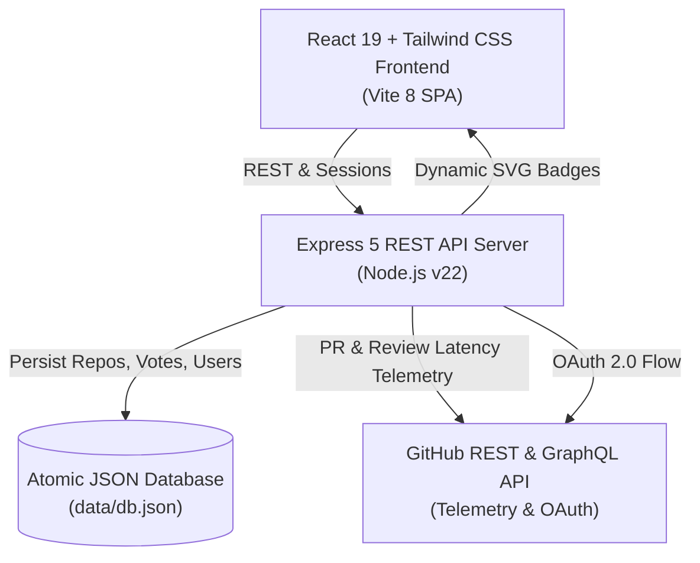

<div align="center">

# ⚡ RepoEasy

### Find open-source repos that welcome outside contributors, ranked by real PR merge rates and maintainer reply times.

[](#)
[](#)
[](LICENSE)
[](#)
[](#)

[Features](#-key-features) • [Architecture](#-architecture) • [Quickstart](#-quickstart) • [API Reference](#-api-reference) • [Contributing](#-contributing)

</div>

---

## 💡 Why RepoEasy?

Finding an open source project to contribute to is intimidating. GitHub's explore tab and standard `#good-first-issue` searches are filled with:
- **Ghost Repos**: Projects that appear active due to automated bot commits, but PRs sit unreviewed for 6+ months.
- **Gatekept Codebases**: Repositories where maintainers merge 90% of their *own* PRs, but close 80% of *outside contributor* PRs without merging.
- **Broken Onboarding**: Repositories lacking dev environment instructions, templates, or unassigned starter issues.

**RepoEasy changes the game.** We inspect real GitHub PR telemetry, separate external contributors from internal maintainers, calculate the median review response time, and compute an unbiased **EasyScore™** so you only invest your time where contributions are welcomed and appreciated.

---

## ✨ Key Features

### 1. ⚡ Real Outside Contributor PR Merge Rates
Most tools count all merged PRs, artificially inflating scores because maintainers merge their own code. RepoEasy checks GitHub author associations (`CONTRIBUTOR`, `FIRST_TIME_CONTRIBUTOR`, `NONE` vs `OWNER`, `MEMBER`) to calculate the **true percentage of outside PRs merged vs closed**.

### 2. ⏱️ Median Maintainer Reply Times
Measures the median time from PR submission to first maintainer review or triage. Filter specifically for **Lightning Maintainers (< 4 hours)** or projects with under 24-hour review turnarounds.

### 3. 🏆 EasyScore™ (0–100 Welcoming Index)
A transparent, multi-factor contributor readiness index:
- **35%**: Outside PR Merge Rate
- **25%**: Maintainer First Review Response Time
- **15%**: Open, unassigned Good First Issues availability
- **15%**: Community & Onboarding health (`CONTRIBUTING.md`, Code of Conduct, PR templates)
- **10%**: 30-day commit velocity & release cadence

### 4. 🚀 1-Click "Quick Contribute" Hub
Click **Quick Contribute** on any repository card to:
- Browse live, unassigned `good first issue`s ready to claim.
- Launch directly into a pre-configured **GitHub Codespace** with 1 click.
- Launch in **Gitpod**.
- Copy the exact clone & setup commands for local development.
- View onboarding guidelines and tips for fast approval.

### 5. 🛡️ Dynamic Embeddable README Badges
Maintainers can generate and embed live SVG shields into their GitHub README to showcase their contributor friendliness:
```markdown
[](https://github.com/DhanushNehru/RepoEasy)
```

### 6. 🔐 Sign in with GitHub & Contributor Watchlist
- Official GitHub OAuth 2.0 authentication.
- **1-Click Instant Contributor Sign-in** for fast zero-config local testing.
- Upvote community projects and bookmark repositories into your personal **Contributor Watchlist**.

### 7. ➕ Instant Repository Submission & Analyzer
Submit any public GitHub repo (`owner/repo` or full URL). RepoEasy's background analyzer inspects pull requests, response timestamps, and open issues, computes the EasyScore™, and immediately indexes it into the directory.

---

## 🏗️ Architecture



---

## 🚀 Quickstart

### Prerequisites
- Node.js 20+ (Node 22 recommended)
- npm 10+

### Installation & Run

```bash
# 1. Clone the repository
git clone https://github.com/DhanushNehru/RepoEasy.git
cd RepoEasy

# 2. Install dependencies
npm install

# 3. (Optional) Configure environment variables
cp .env.example .env

# 4. Build and start production server
npm run build
npm start
```

Open `http://localhost:4000` in your browser!

### Running in Development Mode

```bash
# Terminal 1: Backend server
npm run dev

# Terminal 2: Frontend with Hot Reloading
npx vite
```

### Docker Deployment

```bash
# Run with Docker Compose
docker compose up -d
```

### Vercel Deployment

The repo deploys to Vercel as a static frontend plus a serverless API
(`api/index.js` wraps the Express app; `vercel.json` routes `/api/*` to it).

1. Import the repo into Vercel (Vite preset, defaults are fine).
2. Connect an Upstash Redis store to the project with the `KV` environment
   prefix. The API persists users, votes, bookmarks and submitted repos there.
   Without it, the API falls back to the bundled seed data and changes are
   not kept between runs.
3. Set the environment variables from the table below (Production scope) and
   redeploy: `GITHUB_CLIENT_ID`, `GITHUB_CLIENT_SECRET`,
   `GITHUB_CALLBACK_URL` (`https://<your-app>.vercel.app/api/auth/github/callback`),
   and `SESSION_SECRET` (a long random string, e.g. `openssl rand -hex 32`).

---

## 🧪 Testing

RepoEasy comes with automated unit and integration tests using Node's native test runner:

```bash
npm test
```

Test coverage includes:
- GitHub URL and shorthand syntax parsing.
- EasyScore™ weighting algorithms and score boundaries.
- Maintainer reply time clamping and badge evaluation.
- Category inference with word-boundary accuracy.
- Database filtering, searching, and sorting operations.

---

## 📡 API Reference

| Endpoint | Method | Description |
| :--- | :---: | :--- |
| `/api/repos` | `GET` | Filter, search, and rank repositories by merge rate, reply time, language, or score. |
| `/api/repos/:owner/:repo` | `GET` | Get detailed telemetry and open good first issues for a specific repo. |
| `/api/repos/analyze` | `POST` | Analyze any GitHub URL or shorthand in real-time (preview mode). |
| `/api/repos/submit` | `POST` | Analyze and index a repository into the directory. |
| `/api/repos/:owner/:repo/vote` | `POST` | Toggle upvote on a repository (requires GitHub login). |
| `/api/repos/:owner/:repo/bookmark` | `POST` | Toggle bookmark on a repository (requires GitHub login). |
| `/api/badges/:owner/:repo.svg` | `GET` | Generate dynamic SVG badge for GitHub READMEs. |
| `/api/auth/me` | `GET` | Returns authenticated user profile and session state. |
| `/api/auth/demo-login` | `POST` | Instant 1-click test sign-in as verified contributor. |
| `/api/auth/github/login` | `GET` | Initiates GitHub OAuth 2.0 redirect. |
| `/api/stats` | `GET` | High-level directory statistics (avg merge rate, median reply, starter issues). |

---

## ⚙️ Environment Variables

| Variable | Required | Default | Description |
| :--- | :---: | :--- | :--- |
| `PORT` | No | `4000` | Port for the Express server |
| `NODE_ENV` | No | `development` | Runtime environment (`development` / `production`) |
| `GITHUB_TOKEN` | No | `""` | GitHub Personal Access Token (raises rate limit to 5,000 req/hr) |
| `GITHUB_CLIENT_ID` | No | `""` | GitHub OAuth App Client ID |
| `GITHUB_CLIENT_SECRET` | No | `""` | GitHub OAuth App Client Secret |
| `GITHUB_CALLBACK_URL` | No | `http://localhost:4000/api/auth/github/callback` | OAuth redirect callback URL |
| `SESSION_SECRET` | No | `repoeasy_dev_secret_key` | Secret key for signed cookie sessions |

---

## 🤝 Contributing

We welcome outside contributors! Check out our [CONTRIBUTING.md](CONTRIBUTING.md) guide for setup instructions and a list of starter tasks.

Maintainers review every external pull request within **24 hours**.

---

## 📄 License

This project is licensed under the [MIT License](LICENSE) © 2026 [Dhanush Nehru](https://github.com/DhanushNehru).
